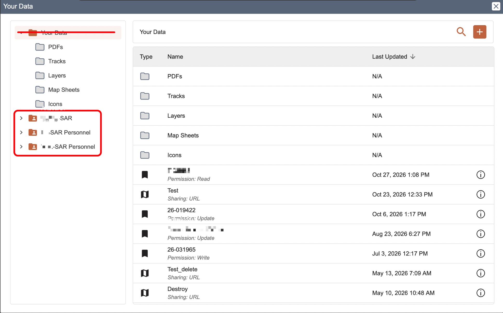
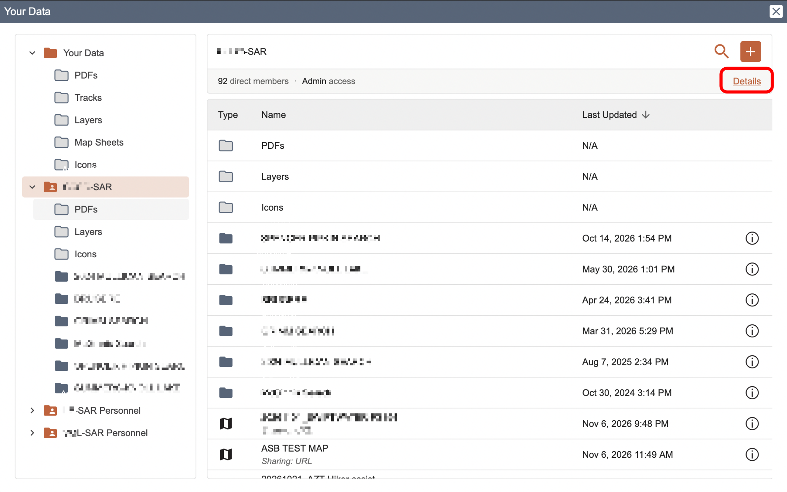
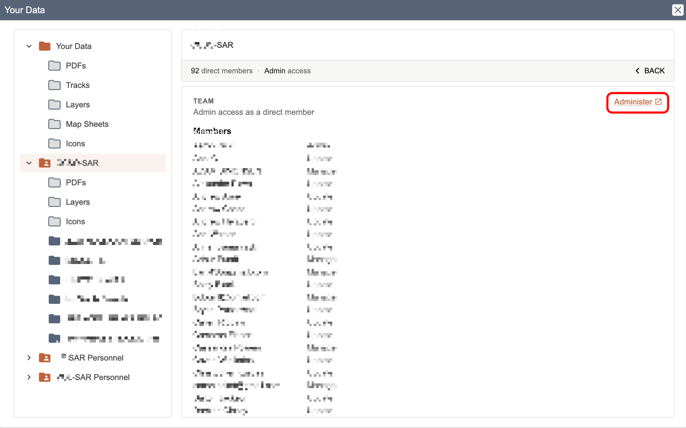
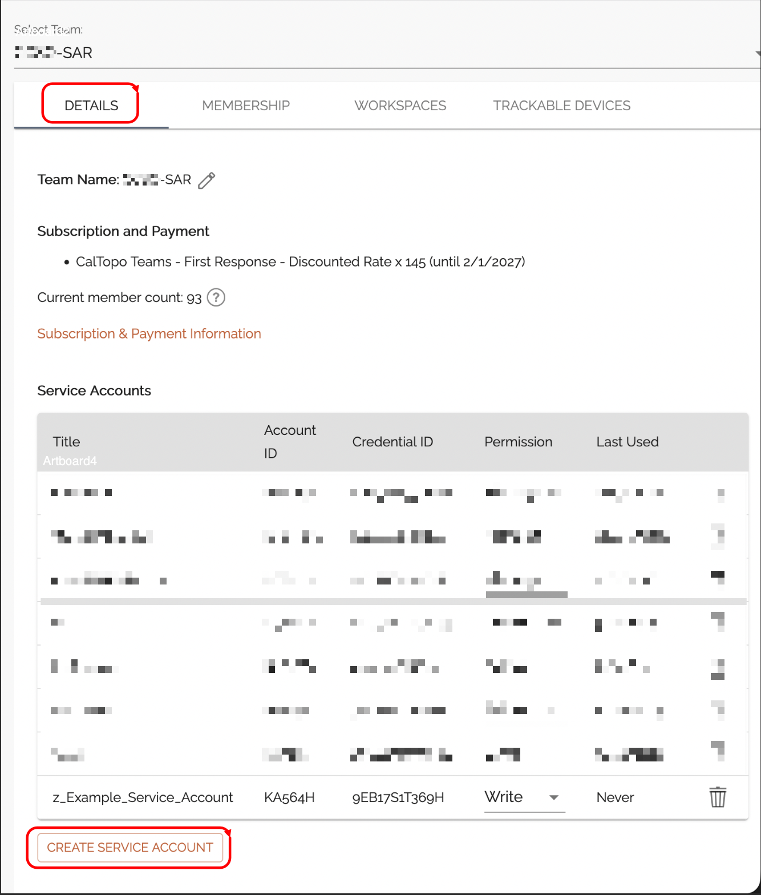
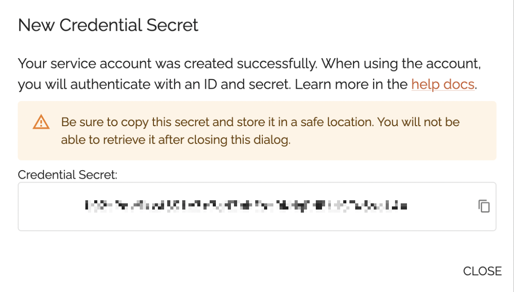
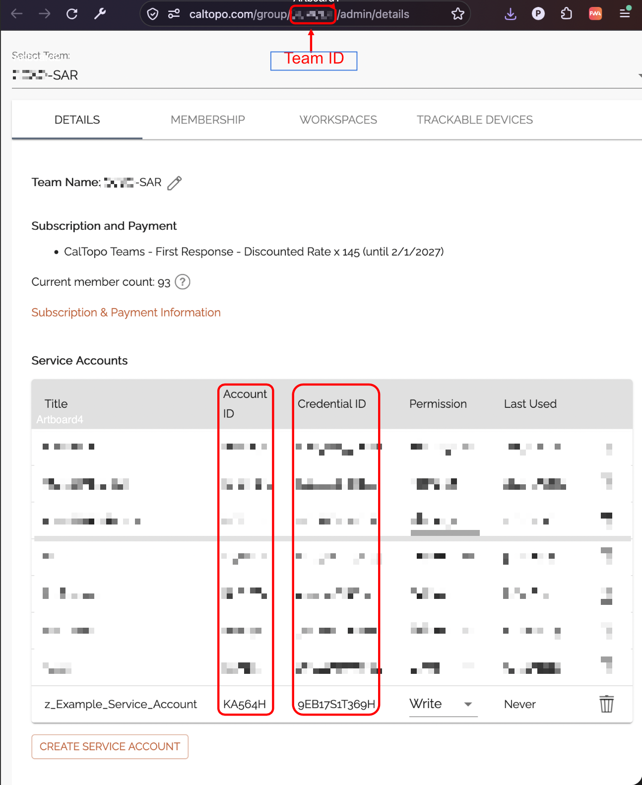

# ETL-CalTopo

Bring CALTopo Maps into the TAK System

## Modes

The Layer supports two independent data flows, the Outgoing flow is off unless configured.

- **Incoming** (Schedule) - Ingests the objects of a single shared CalTopo Map, or the live Shared Locations of a CalTopo Team Account
- **Outgoing** (`event:create`) - Creates a new CalTopo Map in a Team Account when a CoreEvent flagged `caltopo_map` is created and shared with the Layer Connection

## Outgoing - CoreEvent to CalTopo Map

Enable the Outgoing flow of the Layer and subscribe it to `event:create`. The Service Account requires at minimum `Update`
permissions on the Team (see Team Access Token below) and the Layer requires the `event:read` & `event:update` permissions.
Each created Map is titled after the CoreEvent callsign and contains a single Marker at the Event location whose description
carries the Event remarks and human readable location.

Only Events whose `metadata` has `"caltopo_map": true` get a Map - the CalTopo Sync plugin's Create Caltopo Map sets it.
Other plugins create Events too (ie: an incident and each OP's field team), so set `MapEvents` to `All` only on a Layer
that should map every Event.

The Map ID is filed under the `caltopo` external ID of the CoreEvent, so an Event that already has one (ie: a redelivered
message) never gets a second Map. Unless the Map is `PRIVATE`, its URL is also added to the Links of the CoreEvent.

| Variable           | Default               | Description                                                                                 |
| ------------------ | --------------------- | ------------------------------------------------------------------------------------------- |
| `AccountId`        |                       | Service Account ID the credentials belong to - required by `event:create`                   |
| `TeamId`           |                       | Team ID the Maps are created in, from the Team admin page URL `https://caltopo.com/group/{TeamId}/admin/details` - required by `event:create` |
| `CredentialId`     |                       | Service Account Credential ID - required by `event:create`                                  |
| `CredentialSecret` |                       | Service Account Credential Secret - required by `event:create`                              |
| `MapEvents`        | `Flagged`             | `Flagged` (only Events with `metadata.caltopo_map: true`) or `All`                          |
| `MapMode`          | `sar`                 | `sar` (Search & Rescue) or `cal` (Recreational)                                             |
| `MapSharing`       | `SECRET`              | `PRIVATE` (creator only), `SECRET` (secret URL), `URL` (public URL) or `PUBLIC`             |
| `MapLayers`        | `[{ "layer": "mbt" }]` | Active base layers - ie: `mbt` (MapBuilder Topo), `mbh` (MapBuilder Hybrid), `imagery`     |
| `MarkerColor`      | `FF0000`              | Hex colour of the Marker placed at the Event location                                       |
| `PLI`              |                       | Forward TAK positions to CalTopo - see below                                                |
| `DEBUG`            | `false`               | Print results in logs                                                                       |

## Outgoing - TAK Positions to CalTopo Trackable Devices

Subscribe the Outgoing flow of the Layer to `feature:*` and set `PLI`. Every CoT the Layer's Connection receives is
streamed to the Layer, and each fresh friendly position sent by a TAK client is reported to CalTopo with the Connect Key of
the first rule its callsign matches. The callsign becomes the device ID in CalTopo. Positions matching no rule are dropped,
and a position CalTopo rejects is logged rather than retried, as a retry would already be out of date.

A PLI only Layer can leave the `event:create` settings blank.

| Variable                      | Default     | Description                                                                         |
| ----------------------------- | ----------- | ----------------------------------------------------------------------------------- |
| `PLI.ConnectKeys[].Name`      |             | Label for the rule in the logs - ie: `Volunteers`                                   |
| `PLI.ConnectKeys[].ConnectKey` |            | CalTopo Connect Key that receives the positions                                     |
| `PLI.ConnectKeys[].CallsignContains` | `[]` | Match callsigns containing one of these values (case-insensitive) - empty matches all |
| `PLI.Types`                   | `["a-f-G"]` | CoT type prefixes forwarded as positions                                            |
| `PLI.DevicesOnly`             | `true`      | Only forward positions a TAK client sends about itself (battery or TAK version details), not map markers |

Each streamed CoT is one Lambda invocation, so add an Outgoing filter to the Layer to drop everything that is not a
position before it leaves CloudTAK. A filter query that evaluates to `true` drops the CoT, ie:

```
$substring(properties.type, 0, 5) != 'a-f-G'
```

Keep the Layer at its default 256 MB - the task uses about 175 MB even for a single forwarded position, so 128 MB runs out of memory.

## Team Access Token

A Service Account has its own Account ID, a Credential ID and a Credential Secret. The Team it belongs to has a separate
Team ID, visible in the URL of the Team admin page - the Outgoing flow needs both.

The `Team Account` mode requires a Service Account Credential ID and Secret from CalTopo.
You must be an admin of the CalTopo Team to create an access token.

1. Login to [CalTopo](https://caltopo.com) and click "Your Data" in the top bar

   
2. In the popup, click on the team you wish to Administer / configure.

   
3. On the Team page, click the `Details` link.

   
4. On the Members Page, click the `Administer` link.

   
5. On the Team page, click the `Details` tab and then `Create Service Account` to create a new Service Account.

   
6. Create a new Service Account with at minimum `Read` permissions if you only want to receive data from Caltopo (one-way).  If you wish to send data from a TAK DataSync mission and TAK PLI, give it `Write` permissions.
7. Note / Copy the `Credential Secret` - you cannot access it after this without creating a new service account.

   
8. After closing, note and save the other account information:
   - **Team ID:** From the URL between `.../group/` and `/admin/...`
   - **Account ID**
   - **Credential ID**

    

## Development

DFPC provided Lambda ETLs are currently all written in [NodeJS](https://nodejs.org/en) through the use of a AWS Lambda optimized
Docker container. Documentation for the Dockerfile can be found in the [AWS Help Center](https://docs.aws.amazon.com/lambda/latest/dg/images-create.html)

```sh
npm install
```

Add a .env file in the root directory that gives the ETL script the necessary variables to communicate with a local ETL server.
When the ETL is deployed the `ETL_API` and `ETL_LAYER` variables will be provided by the Lambda Environment

```json
{
    "ETL_API": "http://localhost:5001",
    "ETL_LAYER": "19"
}
```

To run the task, ensure the local [CloudTAK](https://github.com/dfpc-coe/CloudTAK/) server is running and then run with typescript runtime
or build to JS and run natively with node

```
ts-node task.ts
```

```
npm run build
cp .env dist/
node dist/task.js
```

## Deployment

### DFPC Users

Deployment into the CloudTAK environment for configuration is done via automatic releases to the DFPC AWS environment.

Github actions will build and push docker releases on every version tag which can then be automatically configured via the 
CloudTAK API.

### Non-DFPC Users

Setting up a CloudTAK from scratch to its first working CalTopo ↔ TAK pair. You do Parts 1–4
once per CloudTAK; Parts 5–9 create the first pair. After that, every further pair is made with
the [CalTopo Sync plugin](https://github.com/clptak/cloudtak-plugin-caltopo-sync)'s **+**
button, which copies the credentials from this first Layer.

> **Two rules that can't be undone**
> - **Never turn Mission Sync off on a Data Sync, and never delete a Data Sync.** CloudTAK
>   **deletes the TAK Mission** when you do either.
> - **CalTopo has no undo.** Every new pair starts as a dry run (Part 8) – read it before going live.

Have these ready:

- The CalTopo **Credential ID**, **Credential Secret**, **Account ID** and **Team ID** from
  [Team Access Token](#team-access-token) above. The Service Account needs **Write/Update** permission for
  two-way sync and map creation.
- A **CalTopo team map** to pair, and its **Map ID** – the part after `/m/` in the map's URL
  (`caltopo.com/m/APJ7U0R` → `APJ7U0R`).
- The **TAK Mission** to pair it with, and its exact name.
- Your CloudTAK's AWS account and the CloudTAK stack set up per `deploy/README.md`.

#### Part 1 – Build and push the ETL image (on your computer)

1. Sign in to AWS from your terminal (use the profile for **this** CloudTAK's AWS account):
   ```bash
   aws login --profile [YOUR_AWS_PROFILE]
   ```
2. Get the code and build and push the image (about 5 minutes):
   ```bash
   git clone https://github.com/clptak/etl-caltopo.git
   cd etl-caltopo
   npm install
   AWS_PROFILE=[YOUR_AWS_PROFILE] AWS_REGION=us-east-1 AWS_ACCOUNT_ID=[YOUR_AWS_ACCOUNT_ID] Environment=[YOUR_AWS_ENVIRONMENT] npx cloudtak-etl
   ```
   `[YOUR_AWS_ENVIRONMENT]` is the middle of your CloudTAK's image store name:
   `tak-vpc-[YOUR_AWS_ENVIRONMENT]-cloudtak-tasks` (e.g. `ccso-dev`).

✅ **Check:** the run ends with lines like
`pushing manifest for …tak-vpc-…-cloudtak-tasks:etl-caltopo-v5.19.1 … done` and `DONE`. If it
ends with an error mentioning `expired` or `credentials`, sign in again (step 1) and rerun it.

#### Part 2 – Register the Integration

1. In CloudTAK, open **Admin** → **Integrations**.
2. Click **+** and complete the form:
   - **Integration Name:** `CalTopo`
   - **Container Prefix:** `etl-caltopo` – the image tag without `-v<version>`. It must match
     exactly, or CloudTAK lists no versions.
   - **Integration Code Repository URL:** `https://github.com/clptak/etl-caltopo`
   - **Integration Markdown Readme URL:** `https://raw.githubusercontent.com/clptak/etl-caltopo/main/README.md`
3. Save.

✅ **Check:** open the Integration – it lists the version you pushed (e.g. `5.19.1`) with a
Capabilities document.

#### Part 3 – Create the Connection

1. In CloudTAK, click **Connections**, then the **+** at the top right of the pane.

   
2. Enter a name (`Caltopo`) and a description.
3. For **Connection Authentication**, use the method that fits your TAK Server. The user (with
   Cert Enrollment) or certificate must be in the **channels (groups)** of the Missions you will
   pair and of the users who should see CalTopo data. Click **Generate Certificate**.
4. When it says **Certificate Uploaded**, click **Save Connection**.

✅ **Check:** the Connection shows green in the Connections list.

#### Part 4 – Create the CloudTAK API token

The sync reads Missions through CloudTAK with a personal API token (Layer tokens can't read
Missions yet).

1. Sign in to CloudTAK as the **service account** user – the one whose certificate is in the
   Missions' channels (often the same account as the Connection's).
2. Open **Settings** → **API Tokens** (`/menu/settings/tokens`) → **+**, name it `CalTopo Sync`,
   and copy the token. Make it on **this** CloudTAK – a token from another CloudTAK fails with
   `Invalid Token`.

#### Part 5 – Create the Data Sync (the Layer's key to the Mission)

1. **Connections** → the `Caltopo` Connection → **Data Syncs** → **+** (Create Sync).
2. **Data Name:** the Mission's **exact** name, including capitals. A matching name attaches the
   existing Mission; anything else creates a **new, empty** Mission.
3. Leave **Mission Sync** and **Mission Layer Diff** on.
4. Click **Create Data**.

✅ **Check:** open the new Data Sync – it shows the Mission's GUID (also visible in the browser
address bar when you open the Mission from the map menu: `/menu/missions/<GUID>/`). Note the GUID
for Part 7.

#### Part 6 – Create the Layer

1. **Connections** → the `Caltopo` Connection → **Layers** → **+**.
2. **Layer Name:** `CalTopo <Map ID>`, e.g. `CalTopo APJ7U0R`. CalTopo items land in a Mission
   folder with this name, so **don't rename the Layer later**.
3. **Task:** CalTopo, the version you pushed.
4. Under **Compute**: **Memory** `256`.
5. Under **Permissions**: tick **all** of them – `feature:*`, `event:read` and `event:update`.
   Without the `event` ones, Create Caltopo Map fails; they can't be added later from the UI.
6. Under **Incoming**: **Create Incoming Config** on, **Scheduled Runs** on, every `1` `Minute`.
7. Under **Outgoing**: **Create Outgoing Config** on.
8. Save the Layer.

#### Part 7 – Give the Layer its Data Sync and settings

1. Open the Layer → **Incoming** → **Config** → the pencil → the gear next to **Data
   Destination** → pick the Data Sync from Part 5 → **Save**. Without it nothing goes from
   CalTopo to TAK.
2. Layer → **Incoming** → **Environment** → **Raw View**. Paste this, fill in the values and
   **Save**. Type the secrets in yourself – never send them by email or chat.
   ```json
   {
       "Source": {
           "Mode": "Sync",
           "CredentialId": "<CalTopo Credential ID>",
           "CredentialSecret": "<CalTopo Credential Secret>",
           "MissionToken": "<API token from Part 4>",
           "Pairs": [
               { "MapId": "<Map ID>", "MissionGuid": "<Mission GUID from Part 5>" }
           ],
           "DryRun": true
       },
       "DEBUG": true
   }
   ```
   One pair per Layer.
3. Layer → **Outgoing** → **Environment**. Fill in **AccountId**, **TeamId**, **CredentialId**
   and **CredentialSecret** (the same CalTopo service account), leave **MapEvents** on
   **Flagged**, and **Save**. This lets the plugin's **Create Caltopo Map** make maps.

#### Part 8 – Read the dry run

Two minutes later: Layer → **Deployment** → **Layer Runtime Logs**. You should see lines like

```
ok - dry run <Mission GUID> -> <Map ID>: 4 Mission items, 12 CalTopo objects, 0 linked - create 4
ok - dry run CalTopo -> TAK: would send 12 CalTopo objects to Data Sync 1
```

Nothing is written yet. Check for:
- **`delete`** of anything that should stay – stop and ask.
- **`401 Invalid Token`** – the token is wrong or from another CloudTAK (Part 4).
- **`400 Error saving object`** – the CalTopo account can't edit the map, or it isn't a team map.
- **`the Layer has no Data Sync`** – Part 7 step 1 was missed.

#### Part 9 – Go live

1. Layer → **Incoming** → **Environment** → **Raw View**: change `"DryRun": true` to `false`,
   then **Save**.
2. On the next run (≤ 1 minute), TAK items appear in the CalTopo map and CalTopo items appear in
   the Mission's `CalTopo <Map ID>` folder.
3. Once it runs cleanly, set `"DEBUG"` to `false`.

✅ **Check:** draw a marker in the CalTopo map – it shows in the Mission within two minutes. In
the CalTopo Sync plugin the pair shows **OK**.

#### Updating to a new version

Push the new image (Part 1), then on each CalTopo Layer: **Deployment** → change the **Task**
version (keep the ticked permissions) → **redeploy the stack** and wait for `UPDATE_COMPLETE`.
Changing the version alone does nothing. The plugin repo's `docs/release-playbook.md` has the
full rollout.
