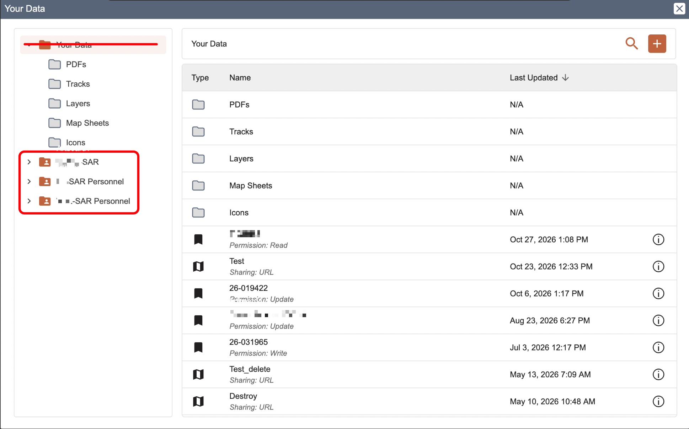
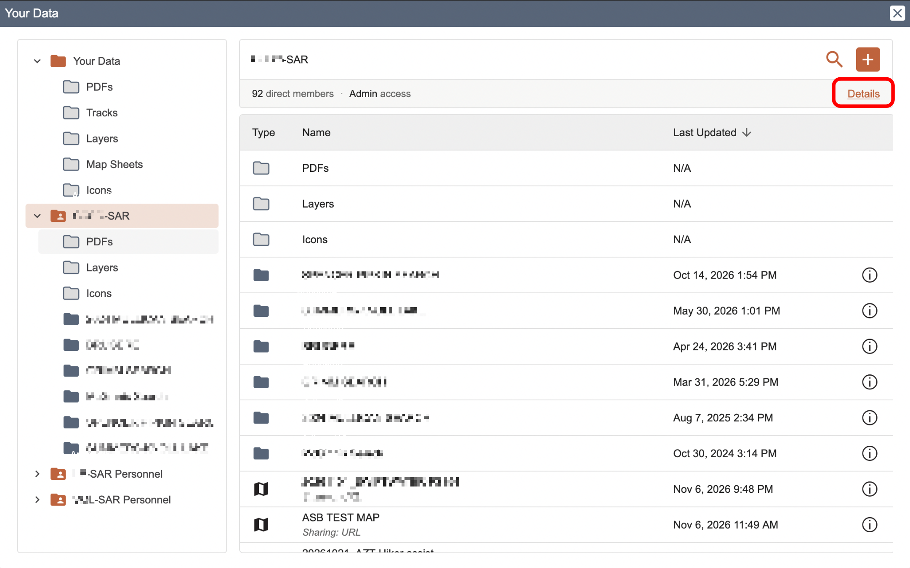
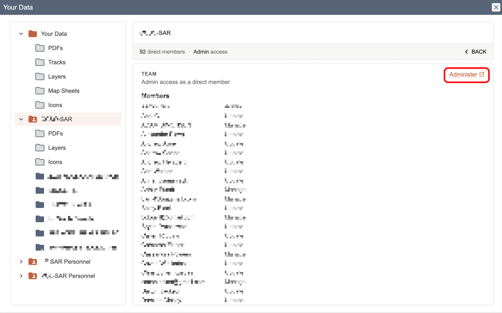
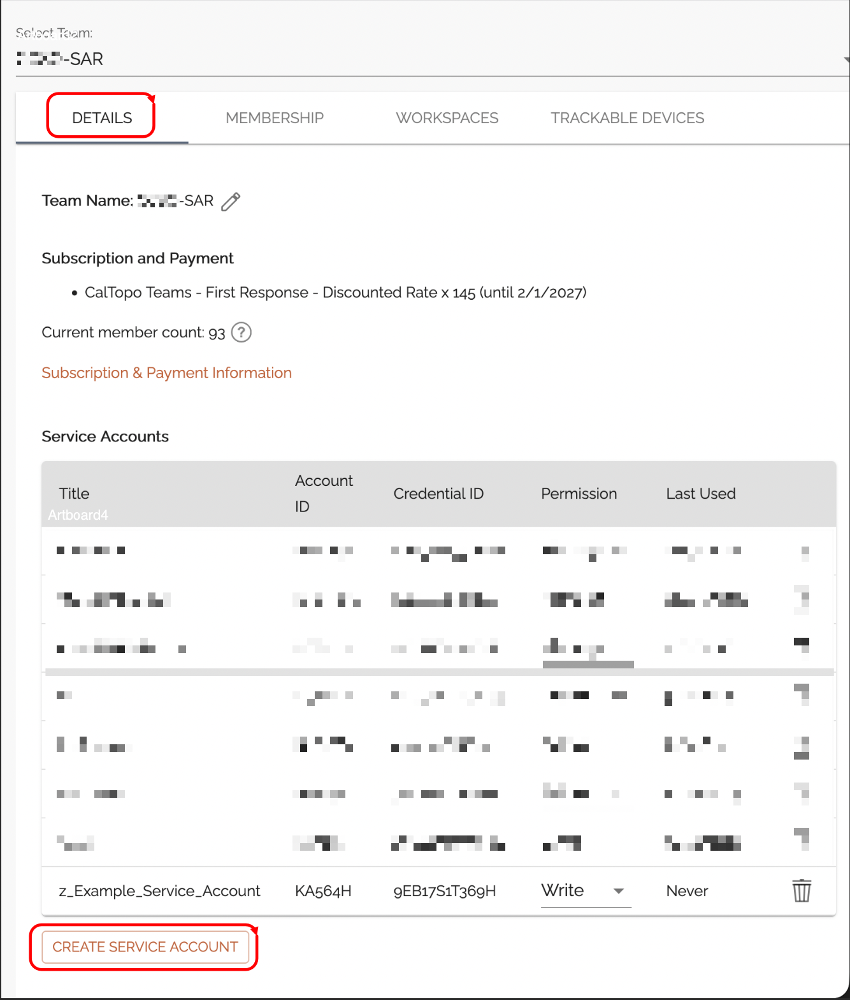
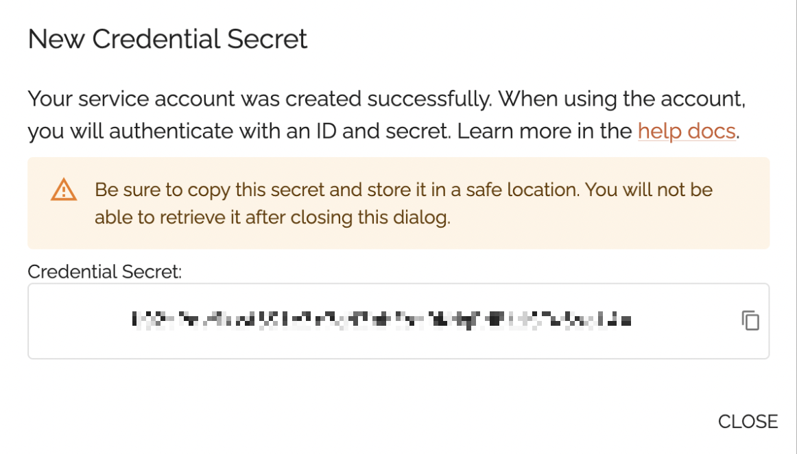
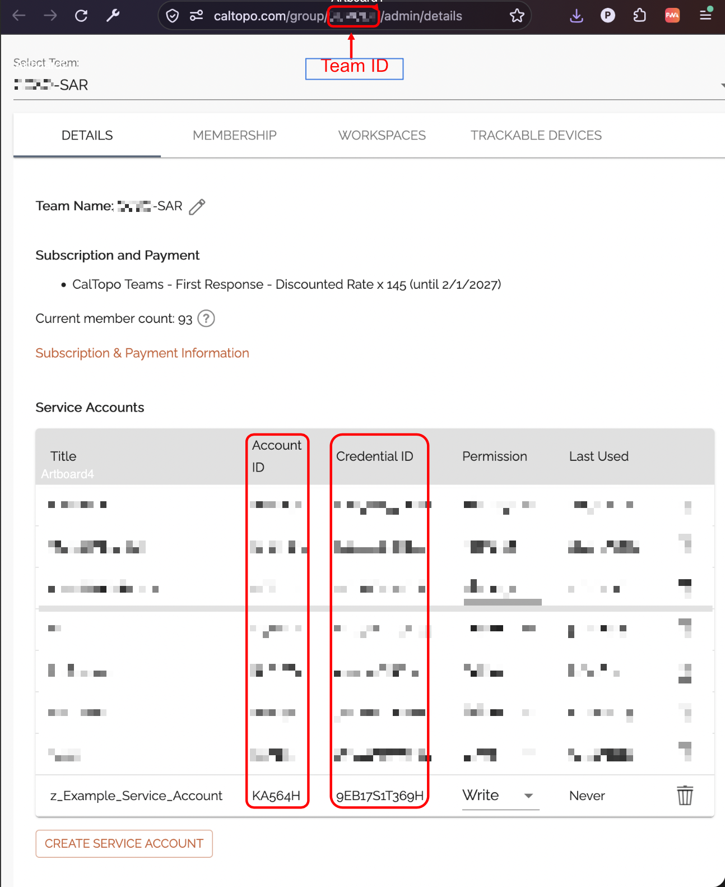

# CalTopo credentials

A Service Account has its own Account ID, a Credential ID and a Credential Secret. The Team it belongs to has a separate
Team ID, visible in the URL of the Team admin page - the Outgoing flow needs both.

The `Team Account` mode requires a Service Account Credential ID and Secret from CalTopo.
You must be an admin of the CalTopo Team to create an access token.

1. Login to [CalTopo](https://caltopo.com) and click "Your Data" in the top bar

   
2. In the popup, click on the team you wish to Administer / configure.

   
3. On the Team page, click the `Details` link.

   
4. On the Members Page, click the `Administer` link.

   
5. On the Team page, click the `Details` tab and then `Create Service Account` to create a new Service Account.

   
6. Create a new Service Account with at minimum `Read` permissions if you only want to receive data from Caltopo (one-way).  If you wish to send data from a TAK DataSync mission and TAK PLI, give it `Write` permissions.
7. Note / Copy the `Credential Secret` - you cannot access it after this without creating a new service account.

   
8. After closing, note and save the other account information:
   - **Team ID:** From the URL between `.../group/` and `/admin/...`
   - **Account ID**
   - **Credential ID**

    
